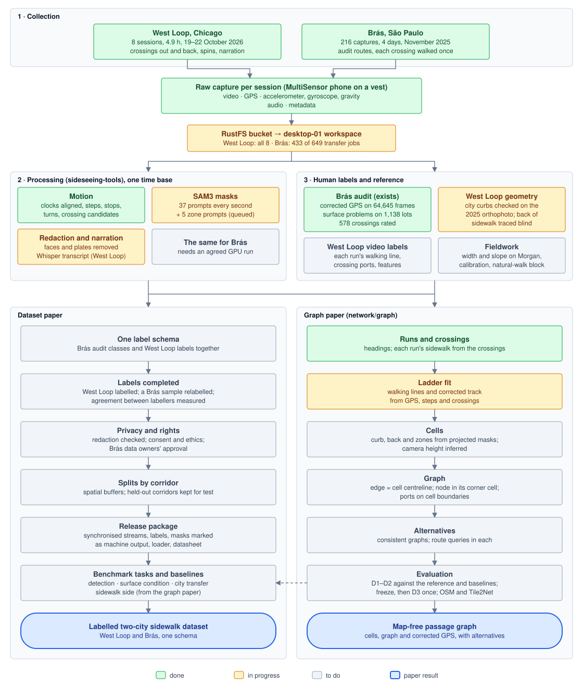

# Two papers: goals, pipeline and phases

Draft, 25 October 2026. The work aims at two papers:
- a **dataset paper**: West Loop (Chicago) and Brás (São Paulo) as one labelled dataset;
- a **graph paper**: the passage graph and its cells, built from the recordings without a map.

This page states each paper's goal, draws the pipeline from collection to both results, and lists the phases that lead to each, with their status. Method detail stays in the [graph and GPS plan](GRAPH_GPS_PLAN_2026-10-24.md); this page links to it rather than repeating it. The graph paper is that plan's "Paper 1". The plan's later papers (alternatives at full scale, revisits chosen by route impact, the aerial union) are outside this page.

## 1. Goals

### Dataset paper

**Goal.** Publish West Loop and Brás as one dataset:
- whole walks recorded with a phone on a vest, every stream on one clock;
- processed by the same pipeline;
- labelled with one schema;
- with fixed splits, benchmark tasks and baselines.

**What would make it worth a paper.** To check against related datasets before writing:
- **Areas, not routes.** Both areas were walked street by street, on both sides, with their crossings. The earlier SideSeeing dataset ([Damaceno et al. 2024](https://arxiv.org/abs/2407.06464): about 3 h around nine hospitals, with a 68-element scene taxonomy) followed routes to hospitals.
- **Two cities, two protocols.** Chicago's grid, with parkways and furniture zones, against Brás's busy commercial streets.
- **Labels at two scales.**
  - The audit's scale: surface condition per lot, and each crossing's ramp, paint and adequacy (Brás).
  - The network's scale: where each sidewalk is, which side each stretch of walking is on, and where crossings end (West Loop).
- **Whole synchronised walks**, not cropped keyframes, so methods that need motion can use them.

**What is in hand, and what is still to make.**

| | West Loop, Chicago | Brás, São Paulo |
|---|---|---|
| Recordings | 8 sessions, 4.9 h, 19–22 October 2026. Morgan (D1); Aberdeen, Madison and Carpenter (D2); Sangamon and Peoria, two collectors at once (D3) | 216 captures in 16 route groups, 9–16 November 2025 |
| Streams | Video 1920×1080 at 30 fps, GPS, accelerometer, gyroscope, gravity, audio with narration | The same app (MultiSensor): video, GPS, three sensor files, cell and Wi-Fi logs |
| Human labels that exist | Spoken code words for sidewalk elements, an evaluation reference only ([PLAN.md](PLAN.md) decision 14) | The audit's GeoPackage, summarised below this table |
| Human labels to make | Geometry: the city's curbs checked and the back of the sidewalk traced (in progress). In the viewer: each run's walking line, crossing ports and features. Tape and inclinometer spots on Morgan | A sample relabelled blind, to measure agreement with the audit |
| Machine output (released, marked as such) | SAM3 masks for 37 prompts plus 5 zone prompts, Whisper transcript, motion events | The audit's frame classifier (crosswalk, curb ramp, surface problem, obstacle). The same SAM3 and motion outputs once run |

The Brás audit's GeoPackage holds:
- corrected GPS for 64,645 frames (6,202 marked to discard), each matched to its fiscal lot (5,035 lots);
- surface problems flagged on 1,138 lots, at two levels plus holes;
- 578 crossings rated adequate (333), partial (75) or inadequate (171), with ramp, paint and the repairs needed.

**Benchmark tasks (proposed).**
1. **Crossing elements:** whether each crossing has a crosswalk, a curb ramp and tactile paving. Labels come from the Brás audit and from West Loop's own labels.
2. **Surface condition** per lot frontage (Brás).
3. **Sidewalk side and GPS correction:** which sidewalk each stretch of walking is on, and how far the corrected track lies from it.
   - References: West Loop's geometry, and Brás's hand-corrected GPS (how it was corrected is still to check).
   - Baselines come from the graph paper.
4. **Transfer between cities:** tune on one city, test on the other.

**Not claimed:**
- Neither area represents its city.
- SAM3 masks are machine output, not ground truth.
- The Brás GPS was corrected by hand to match points to lots. It is a reference with its own error, not a survey.

**Venue.** NeurIPS's datasets track or Scientific Data are candidates. Decide once the schema and the rights are settled.

### Graph paper

**Goal.** From the recordings alone, without a map, build the two linked views of the walkable space:
- the **cells**: polygons, one per sidewalk side per block, one per corner and one per crosswalk, with zones;
- the **graph**: each edge is its cell's centreline, each node sits in its corner cell, and cells connect only through ports.

Correct the GPS in the same inference, and keep alternatives where the evidence cannot decide.

The question stays the critique's: when can sparse phone recordings establish which pedestrian passages connect, and does evidence-aware inference reduce false route claims compared with committing early to one map?

**Claims to test.**

| Claim (a hypothesis) | How it is checked |
|---|---|
| The crossings and turns place each stretch of walking on its sidewalk, without a map | Side identity on the natural-walk block, where the protocol rule does not give the answer |
| The joint fit puts the walking lines inside the sidewalk, nearer its centreline than a GPS + steps smoother does | Phase 2 gate, against the city's curbs and the traced back of the sidewalk |
| The video measures the cells: width, zones, running slope | Tape and inclinometer spots on Morgan; boundary error against the reference |
| Alternatives appear where the decision is genuinely hard, and answering route queries within each consistent graph avoids false routes | Phase 3 on D2's corners; port-to-port reachability |
| The settings hold on new streets and with a second collector | D3, run once with everything frozen |

**Comparisons:**
- **Baselines:**
  - raw GPS, and the 5-fix median;
  - a GPS + steps smoother;
  - the protocol rule;
  - multi-trace clustering;
  - the notebook's OSM-assisted track, as a map-assisted reference, not ground truth.
- **Aerial and map:** Tile2Net and OSM sidewalks on the same blocks, scored against the same reference.
- **Ablations:** without the video side cue, without the crossings, without repeats.

**Not claimed:**
- Independence from the collection protocol, until the natural-walk block says so.
- City scale.
- Cross slope, unless the phone resolves it.

**Venue.** ACM SIGSPATIAL, as the [critique](RESEARCH_CRITIQUE_2026-10-23.md) argues.

### What the two papers share

- **One West Loop reference, made once.** The curbs, the traced back of the sidewalk and the video labels serve both papers: they are the graph paper's evaluation and the dataset's verified West Loop labels. They are made blind to model output, under written instructions.
- **One split.** D3 (Sangamon and Peoria) stays held out for the graph paper, so it is also the dataset's West Loop test split.
- **One set of baselines** for sidewalk side and GPS correction: the graph paper's, reused for the dataset's task 3.
- **One pipeline.** sideseeing-tools does the processing, and its viewer is the labelling tool.
- **Brás may test the graph paper, but that is undecided.**
  - *For:* its hand-corrected GPS says which side each frame is on, so it could test the side inference in another city.
  - *Against:* the Brás protocol walks each crossing once, with no spins, so the ladder's repeated rungs are missing.
  - Decide after phase 3.

## 2. The pipeline

**How to read the diagram:**
- **Colour** is each step's status on 25 October.
- **Three stages feed both papers:** collection, processing (sideseeing-tools on desktop-01) and human labels. All streams share one time base: seconds from the video start.
- **The dashed arrow:** the graph paper's evaluation gives the dataset its sidewalk-side task and baselines.

To update a status, change the box's class in the SVG to `done`, `doing` or `todo`.

## 3. Phases of the dataset paper

| Phase | Work | Gate before moving on | Status, 25 October |
|---|---|---|---|
| **D0. Inventory and transfer** | West Loop's 8 sessions are in RustFS. Brás: 649 transfer jobs from the `2025_Auditoria_Calcadas` Drive folder ([preflight](../../task/dataset-organization/TRANSFER_PREFLIGHT.md)) | Every capture is in a manifest with checksums verified at the destination, or has an exclusion reason | West Loop done. Brás 433 of 649 jobs |
| **D1. The same processing for both** | West Loop: the run on desktop-01 (SAM3, redaction, Whisper, motion), then the zone prompts. Brás: frames, SAM3, redaction and motion with the same code, after estimating GPU time from the captures' durations | Every capture has masks, redacted frames and motion events on one time base, or has an exclusion reason | West Loop: SAM3 on the last D3 session. Brás: not started; the GPU run needs your approval |
| **D2. One label schema** | Map both cities' labels into one schema, at four levels: frame, lot frontage or sidewalk stretch, crossing, and walking run. Each label is present, absent or unknown, and records its provenance (human, or which model). Start from the 2024 taxonomy | Schema and labelling guide frozen | Not started |
| **D3. Labels** | West Loop: the graph paper's phase 1 (shared), plus crossing elements. Brás: import the audit as it is, and relabel a stratified sample blind (for example 50 crossings and 100 lots) | Agreement and effort reported for each label type | West Loop curbs and tracing in progress. Brás audit exists |
| **D4. Privacy, ethics, rights** | Check redaction on a sample and count misses. Decide about audio (collectors' voices, bystanders). Confirm consent and ethics approval for both cities. Get written agreement and a licence from the Brás audit's partners: the team that ran it, Alobrás and IME-USP | Written approvals; redaction miss rate reported | Not started |
| **D5. Splits, tasks, baselines** | Splits by corridor with spatial buffers: West Loop's test split is D3, Brás splits by route group. The four tasks. Baselines: SAM3 zero-shot, the audit's classifier, the graph paper's GPS baselines | Splits frozen before any baseline is tuned | Not started |
| **D6. Release and paper** | Data laid out like the workspace, a loader in sideseeing-tools, a datasheet, a fixed evaluator; then the paper | Someone else reproduces one baseline from the release alone | Not started |

## 4. Phases of the graph paper

Detail in the [plan](GRAPH_GPS_PLAN_2026-10-24.md), section 8.

| Phase | Work | Gate before moving on | Status, 25 October |
|---|---|---|---|
| **G0. Data contract** | Clocks, side cue, zones check, D3's streets and phones | A measured alignment bound for every stream used | Done ([results](GRAPH_PHASE0_RESULTS_2026-10-25.md)) |
| **G1. Reference on D1–D2** | The city's curbs checked and the back of the sidewalk traced on the orthophoto (Renzo, blind). Walking lines and crossing ports labelled in the viewer. Corners double-labelled. Field spots on Morgan | Instructions frozen; disagreement and effort recorded | Morgan in progress (`network/graph/trace.html`) |
| **G2a. Ladder on Morgan** | Steps, headings, each run's sidewalk from the crossings, a joint fit of both sessions, the baselines | **Geometry gate:** the walking lines lie inside the sidewalk and nearer its centreline than the smoother's; the crossing lengths agree with the curb-to-curb width | Built. Geometry sealed until the trace is exported ([notes](GRAPH_PHASE2A_NOTES_2026-10-25.md)) |
| **G2b. Cells on Morgan** | Zone prompts; camera height inferred two ways; curb and back lines from projected masks; width and running slope | Width within about 0.3 m of the tape, or the cells stay outlines (plan section 10) | Waiting for the zone-prompt run |
| **G2c. Fieldwork** | The natural-walk block; a checkerboard video for each phone; tape and inclinometer spots | Side identity measured where the protocol rule does not hold | At the next fieldwork |
| **G3. Corners and alternatives** | D2: Madison's jog, corner cells and ports, alternative groups, route queries within each consistent graph | Alternatives appear where the reference says the decision is hard, not everywhere | Not started |
| **G4. Held-out test** | Freeze every setting; run once on D3 | Results reported whatever they are | Not started |
| **G5. Comparisons** | Tile2Net and OSM on the same blocks; the ablations | — | Not started |
| **G6. Paper** | Write it, with figures from the viewer | — | Not started |

## 5. Order

**Critical paths:**
- **Graph paper:**
  1. The trace on Morgan.
  2. Unseal and evaluate phase 2a.
  3. Fix what that evaluation shows, probably a GPS pull that varies along the street.
  4. The cells (G2b, after the zone-prompt run).
  5. The corners (G3).
  6. Freeze every setting, then run D3 once.
  7. The comparisons.
  8. Write.
- **Dataset paper:**
  1. The Brás transfer.
  2. The Brás GPU run.
  3. The schema.
  4. Labels, with agreement measured.
  5. Approvals.
  6. Splits and baselines.
  7. The release.

**Recommendation: the graph paper goes first.**
- Its data and its development reference exist now.
- The dataset paper waits on the Brás transfer, a GPU run, the schema, and approvals from other people.
- The dataset paper then takes the graph paper's West Loop reference, split and baselines as they are.
- Nothing done for the graph paper is lost: the steps the two share (the West Loop reference, the viewer as the labelling tool) serve both.

## 6. Open decisions, for Renzo

1. **Order and venues.** My recommendation is above.
2. **Brás rights:** who must approve releasing the Brás videos and audit labels.
3. **Brás GPU run:** the same prompts as West Loop, or a subset. It would run after the West Loop run ends.
4. **Brás agreement sample:** its size, and who relabels it.
5. **Audio:** release the narration audio, or only transcripts.
6. **Second labeller** for the West Loop corners. This is already open in the plan.

Out of scope: the hospital collections and River North.

## Sources

- Damaceno et al., [SideSeeing: a multimodal dataset and collection of tools for sidewalk assessment](https://arxiv.org/abs/2407.06464), arXiv 2407.06464, 2024.
- The Brás audit:
  - its report (`RELATÓRIO DA AUDITORIA DE CALÇADAS - BRÁS`, supplied by Renzo; see [COLLECTION_PROTOCOL.md](COLLECTION_PROTOCOL.md));
  - its GeoPackage, `sao-paulo/bras/processed/auditoria_calcada_bras.gpkg` in RustFS. The counts above were read from it on 25 October.
- The Brás inventory: [dataset organization plan](../../task/dataset-organization/README.md).
- The West Loop run: sideseeing-tools `tasks/west-loop-run.md`.
