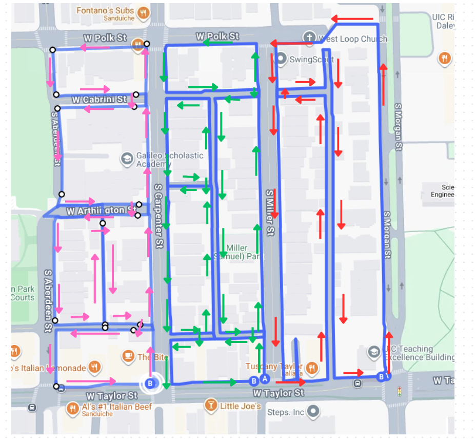

# Near West Side pilot: solo field protocol

**Field version, 14 October 2026.** This pilot collects observations; it does not construct the graph yet. Renzo is the only collector. He will use one **moto g 5G (2023)** running MultiSensor in the existing collection vest. No volunteer or second device is needed.

**Field sequence:** test the phone → mark starts, crossings and overlaps on the map → record pink, green and red one at a time → check each saved session → copy and review the raw data. If a target fails, log it and make a targeted revisit.

## The route at a glance

The researcher's drawing is the route reference. It covers the blue passages between **S Aberdeen St and S Morgan St**, from **W Polk St to W Taylor St**. Follow the colored arrows in three modules, **P (pink)**, **G (green)** and **R (red)**. Collect them in that order, one recording session at a time. The drawing supersedes the earlier Loomis–Racine rectangle and Flournoy-only proposals. The Google Maps background is for orientation, not proof that a path is open or public.

| Module | Trace all blue passages with these arrows | First session ID |
|---|---|---|
| P — pink | Aberdeen–Carpenter: Polk, Cabrini, Arthington, Aberdeen, Carpenter, the drawn south mid-block path and Taylor-side links | P01 |
| G — green | Carpenter–Miller: Carpenter, Polk, Miller, Taylor-side links and the parallel mid-block paths | G01 |
| R — red | Miller–Morgan: Miller, Polk, Morgan, Taylor-side links and the drawn mid-block connections | R01 |

**Core scope:** street-adjacent, non-UIC sidewalks shown by the blue line. **Exploratory scope:** the drawn mid-block paths, including the area around Samuel Miller Park, if they are public, open and non-UIC. Report these separately from the core sidewalk coverage; do not expand into other park paths. The [Chicago Park District lists Samuel Miller Park at 848 S Miller St](https://www.chicagoparkdistrict.com/media/27426), but the listing does not verify each path's present access. Never enter UIC grounds or private property to match the drawing. Record a closed or inaccessible passage as a gap.

The drawing's white circles and A/B markers are Google Maps marks; **ignore them for collection decisions**. They are not graph nodes, route starts or route ends. The arrows are the important marks. Before walking, write the actual start and finish landmarks for P, G and R on a copy of the map and in the field log.

## Before field day: test the phone once

1. Record the actual phone model, Android version, MultiSensor version, camera setting and free storage. Charge the phone and check camera, precise-location and sensor permissions. Keep **Battery Saver off** during capture: Motorola's [moto g 5G (2023) guide](https://help.motorola.com/hc/help.php?c=&m=MOTO+G+5G+-+2023&os=&product=&sku=&type=pdf) says it can stop location services while the screen is off.
2. Put the phone in the vest as it will be worn. Make a short test recording named **T00** in the log: stationary start, straight walk, turn and, if convenient, one legal crossing. Check that the video shows the sidewalk ahead and crossing context without the vest or body blocking the view.
3. Stop, locate the new MultiSensor folder, play part of the video and inspect the export. Check that GPS and inertial files exist, have timestamp fields, and can be aligned with the video using the export's metadata/time conventions. If their clocks cannot yet be related, record that as a test finding rather than assuming the raw numbers share one clock. The model has [GPS, accelerometer and gyroscope hardware](https://en-in.support.motorola.com/app/answers/detail/a_id/174791/~/moto-g-5g-%282023%29---specifications), but the export—not the hardware specification—establishes what was recorded. Preserve T00 even if it fails. Fix settings and repeat as T01, T02, etc. before the main routes.

If a computer is needed to inspect the export, run this test before traveling to the pilot area. A video preview alone does not validate the multimodal recording.

Use the same verified camera, location and sensor settings for P/G/R. Write them in the log. If settings must change, assign a new configuration ID and repeat the short test before continuing.

## On site: mark a working map

At a safe standing point, compare the drawing with what exists on the ground. On a paper or offline map copy:

1. Mark each module's actual **start and finish**, then trace its arrows in the order you will walk. Make a short checklist of each drawn physical passage. Colored arrows specify direction on a passage; they do not guarantee that every passage joins into one continuous walk. Mark any connecting travel as repositioning. Opposite sides of a street are separate targets; one recorded direction is enough for the pilot.
2. Number each road crossing you plan to **traverse**: C-P-01, C-G-01 or C-R-01, plus the intersection and crossing arm. A crossing merely visible from a sidewalk does not count.
3. Mark **O-PG** as a short section of the *same physical sidewalk* to record in both P and G, near the Carpenter/Taylor handoff. Mark **O-GR** similarly near Miller/Taylor. The north sidewalk of W Taylor for roughly 15–25 m after each handoff is a candidate, not a verified location. Choose recognizable endpoints on site and write them on the map. If a candidate is unsuitable, choose another safe shared section before recording. Meeting at one point is not a passage overlap.
4. Mark any closed, private, UIC or otherwise unavailable path. Keep it in the target list with a reason; do not invent a connection or force a detour.

The first completed module measures the effort for the next two. Modules may be recorded on different days. There is no assumed one-day completion time.

## Record one module, check it, then continue

Repeat these steps for **P, G and R**:

1. Start a fresh MultiSensor recording. Log the session ID (P01, G01, R01), actual start time and landmark, battery and free storage. Preserve the original app folder name in the log. Check that the camera view and location updates are active while standing still.
2. Walk the drawn blue passages in the module's colored-arrow directions at a normal pace. Keep the phone fixed in the vest. Record each crossing continuously through **approach → wait → traverse → arrival**. Do not stop on a corner or cross diagonally where there is no diagonal facility. Follow traffic rules.
3. At a safe stopping point, note any missed branch, closure, interrupted recording, camera obstruction or GPS concern. Label walking needed only to reach the next target as **repositioning**, not unique coverage. Keep recording the premarked O-PG/O-GR section in both adjoining sessions; count that physical section only once in unique coverage.
4. Stop after the final passage or transition is visible. Confirm the file saved and the video plays. Tick off only passages and crossings actually traversed. Log end time, battery/storage, overlap endpoints, problems and any target needing a revisit before starting the next module.

If a recording stops unexpectedly, keep its files and start a new ID such as P02. Resume at a recognizable landmark with a short, logged shared section. Do not rename or overwrite the failed capture. If a path cannot be used, retain its **unavailable** status rather than replacing it silently with another path.

## After each outing: preserve and check the data

Copy every original MultiSensor folder intact and retain the field map and log. Verify the copies open and contain the expected video, metadata, GPS and inertial files before deleting anything from the phone. Keep failed attempts. Each manifest row links the session ID to its original folder.

Classify each drawn target as **usable**, **partial / revisit**, **unavailable** or **excluded**. A multimodal session is usable when relevant video, GPS and inertial data can be aligned in time using documented metadata, its route can be identified and its critical turns/crossings are visible without a disabling interruption. Note gaps and drift without hand-shifting GPS or modifying raw evidence. Re-record only affected targets when possible, using a new session ID and logged overlap.

Make **one card per recording** (including T00 and any restart). Fill it immediately after stopping:

| Field | Write here |
|---|---|
| Session ID and original MultiSensor folder | |
| Date; actual start/end times and landmarks | |
| Battery and free storage before/after | |
| Video, GPS and inertial export check | |
| Drawn passages and crossings actually traversed | |
| O-PG or O-GR endpoints; repositioning | |
| Interruption, closure, camera/GPS problem, retake target | |
| Final status: usable / partial / unavailable / excluded | |

On the first card of each outing, also write phone model, Android and app versions, acquisition settings, vest orientation, weather/lighting and map revision. Add cards for restarts or retakes. A map tick is not itself proof of a usable capture.

## First review and completion rule

Plot **raw, time-ordered GPS** from each session over a documented public aerial image; distinguish modules, overlaps and failed sessions. The [Cook County imagery service](https://gis.cookcountyil.gov/imagery/rest/services/Basemap/CookImagery/ImageServer) and [2025 orthophoto service](https://img.cookcountyil.gov/imagery/rest/services/CookOrtho2025/ImageServer) are candidates. Record imagery year, retrieval date and spatial reference. Inspect video and sensor intervals at turns, crossings and overlaps. Report GPS drift separately from missing observations; do not manually repair either in the original data.

The pilot is complete when **every drawn, eligible passage and planned crossing has an explicit final status**; P/G/R and their actual overlaps link to preserved raw folders; street-adjacent and exploratory mid-block coverage are reported separately; and actual walking, repositioning, setup, transfer, review, storage and battery costs are recorded. A closed path is a documented finding, not covered distance. The drawing is a collection plan, not verified graph topology or evaluation ground truth. This pilot does not imply coverage of all Near West Side sidewalks.

Related documents: [route drawing and rationale](PILOT_NEAR_WEST_SIDE.md), [broader collection protocol](COLLECTION_PROTOCOL.md), and [research plan](PLAN.md).
