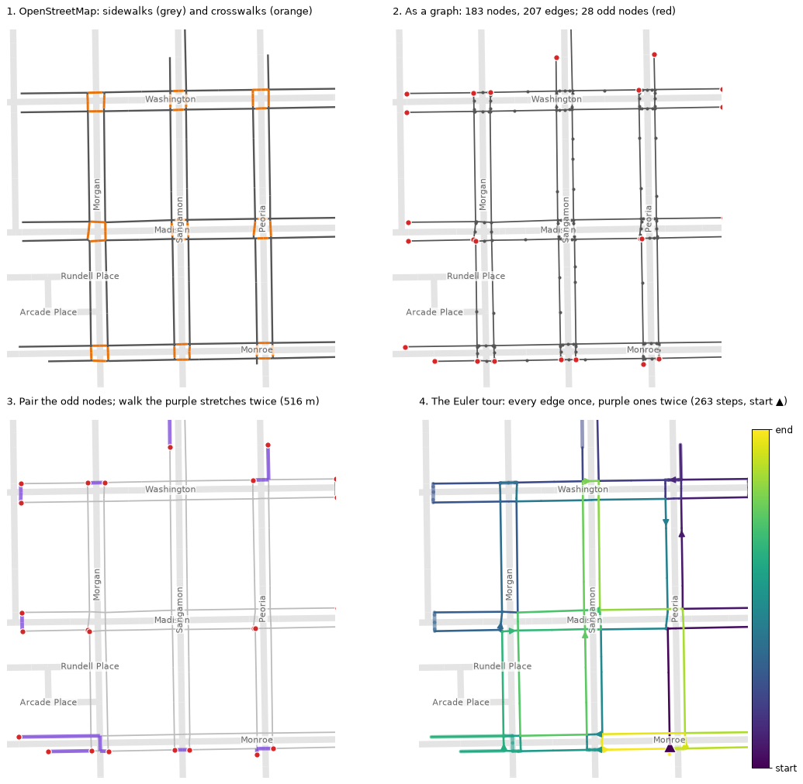

# How the West Loop routes are made

This document explains, step by step, how the West Loop route plans are produced, from downloading the sidewalk map to the files used in the field. It assumes no background in maps, graphs or optimisation: every term is explained where it first appears. The design decisions and their discussion are in [WEST_LOOP_COLLECTION.md](WEST_LOOP_COLLECTION.md); this document is about **how** the routes are computed.

The whole process is two scripts:

```
 OpenStreetMap          routes.py                       route_methods.py                   results
 (free world map)  ──►  which sidewalks must be    ──►  the walkable network as a     ──►  map.html, GPX tracks,
  download once         walked, and the "module"        graph; four ways to divide         routing.gpkg (QGIS),
                        plan: one street per            it into routes; compare them       compare.csv, plans.png
                        session                         (about 2 min)
                        (about 45 s)
```

## 1. The problem in plain words

We want to record **every sidewalk side and every legal crosswalk** in West Loop at least once: 101 km of sidewalk and 937 crosswalks (14 km), 115 km in all. The collector walks with the phone recording in a vest. Practical limits:

- a recording **session** should last at most about 30 minutes, so a failed recording loses little;
- a field **day** is at most about 3 hours;
- every session costs 40 s of fixed routine: 30 s standing still at the start and 10 s at the end (rules F1 and F2);
- the phone is inside the vest, so the collector cannot look at a screen while recording.

A plan is good when it needs **little extra walking**, **few days**, **few sessions**, and is **easy to follow on foot**. These goals pull against each other, which is why four plans are computed and compared.

Why there is extra walking at all: try to draw the outline of a city block and its crosswalks without lifting the pen and without going over any line twice. Usually it cannot be done. Some lines must be walked twice (**repeats**), or the pen must be lifted and moved (**transfers**: walking with the recording stopped). The methods below differ in how they choose those repeats and transfers.

## 2. Step 1: download the sidewalk data

**OpenStreetMap (OSM)** is a free world map drawn by volunteers. Chicago's sidewalks and crosswalks are mapped in it in detail. OSM stores three kinds of things:

| OSM object | What it is | Example |
|---|---|---|
| **Node** | A point, with an ID number and a latitude and longitude | A street corner, a curb ramp |
| **Way** | An ordered list of nodes: a line | A sidewalk along one block |
| **Tag** | A label `key=value` attached to a node or way | `footway=sidewalk`, `footway=crossing`, `crossing=traffic_signals`, `highway=residential`, `name=West Lake Street`, `bridge=yes`, `layer=-1` |

The tags are how the scripts know what each line is. A sidewalk is a way tagged `highway=footway` + `footway=sidewalk`. A crosswalk is `footway=crossing`, and if it also has `crossing=traffic_signals` it has a pedestrian signal. A street centreline is `highway=residential` (or `tertiary`, `secondary`, …).

The data come from the **Overpass API**, a public service that answers questions about OSM. `routes.py` asks it for everything inside a rectangle around West Loop (south 41.868, west −87.675, north 41.898, east −87.628):

- every way with a `highway` tag (streets, sidewalks, crosswalks, paths, steps);
- the Chicago River;
- railways;
- crossing nodes.

The answer includes each way's tags, its node IDs and the coordinates of its nodes. It is saved once as `data/west_loop/osm_2026-10-19.json`: 12 MB, with 17,273 ways and 3,440 crossing nodes. Every later run reads this file instead of downloading again, so the results do not change when someone edits OSM. To start again from fresh data, delete the file. If one Overpass server is busy, the script tries two others in turn.

Latitude and longitude are angles, not metres. All geometry is therefore converted to **UTM zone 16N**, a flat map projection in metres, so that lengths and distances come out in metres.

## 3. Step 2: decide what must be walked (`routes.py`)

### 3.1 Draw the area

The boundary is made from the centrelines of **Grand Ave** (north), **Ashland Ave** (west) and **Tilden St** (south, the north rim of the I-290 trench), and from the **Chicago River** (east). The script draws a rectangle from the three street lines and cuts it with the river line. The piece that contains a known inside point (Racine and Randolph) is the **core** area, 4.01 km².

Both sides of a boundary street are collected, so the **collection area** adds a 30 m band beyond each boundary street to catch its outer sidewalk: 4.21 km².

### 3.2 Pick the pieces

Inside the collection area, the script keeps every sidewalk and crosswalk, and drops two kinds of bridge:
- **River bridges**, which lead out of the area. So do bridges over I-290.
- **Bridges over the Kennedy and over rail are kept**: every east–west street crosses the Kennedy on one.

Every line is then cut into **pieces**, the straight segments between two consecutive OSM nodes. West Loop has 6,332 pieces.

### 3.3 Give each piece a street and a side

The plan walks one street at a time, so each piece must know which street and which side it belongs to.

- **Street.** The script looks for street centrelines within 30 m of the piece that run in nearly the same direction (within 35°). It picks the nearest one. A sidewalk along Lake St is parallel to Lake St and close to it, so it belongs to Lake.
- **Side.** It checks whether the middle of the piece lies to the left or the right of the street's line. Left of an eastbound street is its north side; left of a northbound street is its west side.
- **Crosswalks follow the same rule.** A crosswalk across Halsted at Lake runs east–west, so it is parallel to Lake and belongs to Lake's module. This is the **straight-ahead rule**: walking along Lake, you cross Halsted straight ahead and stay on Lake.

```
           Halsted
             │ │
 ════════════╡ ╞════════════  Lake St, north sidewalk  ──► belongs to LAKE, side N
   crosswalk ─┼─┼─  (runs east–west, so it belongs to LAKE too)
 ════════════╡ ╞════════════  Lake St, south sidewalk  ──► belongs to LAKE, side S
             │ │
```

### 3.4 Modules and legs

All the pieces of one street form a **module**. A module is walked out along one side and back along the other:
- **East–west streets:** the **out leg** is the north side, walking east; the **back leg** is the south side, walking west.
- **North–south streets:** the out leg is the east side, walking north; the back leg is the west side, walking south.
- **The U-turn:** at the far end of the out leg the collector crosses the street (the U-turn) before starting the back leg.

Each leg is one recording session. Three adjustments are specific to West Loop:

- **Split at Halsted.** East–west streets are 2.3 km long, so they become two modules, `_WEST` and `_EAST`. This happens only when both parts have at least 100 m of sidewalk.
- **Runs.** Where a street's centreline is interrupted for more than 60 m, each piece becomes its own module, lettered `_A`, `_B`, …. The cause can be a rail line at grade, the Kennedy or a park. The collector cannot walk straight through such a break.
- **Tiny modules.** A module of less than 50 m goes to a review list instead.

The result is 78 modules and 154 legs, with 6,106 pieces (115.3 km) assigned and 1.6 km left for review. For each leg the script also measures `gap_m`, the length along the street where OSM maps no sidewalk: a site check.

Outputs: `sessions.csv` (one row per leg), `cards/` (one route card per module), `overview.png`, `unassigned.csv` (the review list) and `routes.gpkg` (all pieces, for GIS).

## 4. Step 3: turn the map into a graph (`route_methods.py`)

To compute routes, the map becomes a **graph**: a set of **nodes** (dots) joined by **edges** (lines). Here a node is an OSM node and an edge is the segment between two consecutive nodes of a way. What matters in a graph is **who connects to whom**. Two sidewalks are connected only if OSM gives them a shared node, so the graph uses the OSM node IDs, not just the drawing.

Panel 2 of the figure below shows four blocks as a graph. The West Loop graph has 37,649 nodes and 48,106 edges:

| Edge type | Count | Role |
|---|---:|---|
| Sidewalk | 12,126 | Survey target if `routes.py` assigned it |
| Crosswalk | 6,626 | Survey target if `routes.py` assigned it |
| Other footpath (park paths, plazas, steps) | 11,511 | Connector only |
| Street centreline | 17,843 | Connector of last resort: walking where no sidewalk is mapped |

**Survey targets** (also called *required edges*) are the edges under the pieces that `routes.py` assigned to a module: 6,126 edges, 115.1 km. They are the same 115.3 km less 0.2 km on ways that OSM tags private. Every other edge is a **connector**: it may be used to get from one target to another, but nobody needs to walk it.

Each edge has a **cost in seconds of field time**:
- **Walking:** length ÷ 1.4 m/s, the pilot's walking speed.
- **Street centrelines:** this time counts three times over, so a route uses a street only when nothing else connects.
- **Crosswalks:** each adds a wait, 35 s if it has a signal (the mean of Pilot 2's four signal stops) and 3 s otherwise (the curb pause, rule F3).

Because the costs are in time, a route that crosses a signal twice pays two waits.

## 5. The ideas behind the methods

These eight ideas are all that is needed to understand the four methods.

**5.1 Degree and odd nodes.** The **degree** of a node is the number of edges that meet there. Passing through a node uses two edges, one in and one out. So a walk that uses every edge exactly once can pass through a node only if its edges pair up, which means an even degree. A node with an odd degree forces the walk to start or end there, or to use some edge again. This is **Euler's rule** (1736, the bridges of Königsberg):
- a closed walk that uses every edge exactly once exists **if and only if** the graph is connected and every node has an even degree;
- such a walk is an **Euler circuit**.

Sidewalk maps have many odd nodes:
- **dead ends (degree 1):** a sidewalk that stops, or the edge of the area;
- **T-junctions (degree 3):** a crosswalk joining the middle of a straight sidewalk.

West Loop's survey targets have **592 odd nodes** among 5,469, of which 258 are dead ends.

**5.2 Repeats make odd nodes even.** Walking a path a second time adds one edge at each of its two ends, and two edges at every node in between. So repeating the path between two odd nodes makes both even and leaves every other node as it was. The fix is therefore to **pair up the odd nodes and repeat a path between each pair**. The whole question becomes which pairs, and which paths.

**5.3 Shortest path (Dijkstra's algorithm).** This finds the quickest route between two nodes. Picture a ripple spreading from the start: at each step, the closest node not yet reached is settled, and its neighbours are updated. When the target is settled, its route is the quickest. Every "quickest way to get from A to B" below is computed this way, on the time costs.

**5.4 Minimum-weight matching.** Given the odd nodes and the cost of linking any two of them, a **matching** splits them into pairs. A **minimum-weight matching** is the pairing with the smallest total cost.
- Pairing greedily, closest pair first, can be poor: an early cheap pair can strand two nodes that then need a long repeat.
- The matching algorithm (Edmonds' blossom algorithm, in the `networkx` library) finds the best pairing among the allowed pairs.
- To keep it fast, each odd node may pair only with its 10 nearest odd nodes within 20 minutes' walk.
- Any node left without a partner is paired with the nearest one left.

**5.5 Euler circuit (Hierholzer's method).** Once every node is even and the graph is connected, a circuit is found like this:
1. Walk from the start until you return to it.
2. Then, from any node on that loop that still has unused edges, walk another loop and splice it in.
3. Repeat until no edges are left.

The result is an ordered list of steps: the route.

**5.6 Joining separate pieces (minimum spanning tree).** Sometimes the targets form separate islands, and no amount of pairing connects them. The script:
- computes the quickest connection between every two islands;
- keeps the cheapest set of connections that links all the islands without forming a loop, which is called a **minimum spanning tree** (the same problem as building the cheapest set of roads that links a group of towns);
- adds those connections as repeats.

**5.7 Travelling salesman (TSP).** This means visiting a list of places, each once, in the shortest order. The exact answer is very hard to find for many places, so a good heuristic is used:
1. Start from a greedy order.
2. Try swapping two places at a time.
3. Accept any change that is not much worse than the current order. Early in the search a bigger setback is allowed, which helps escape poor orders; the allowance shrinks over time.

This is called *threshold accepting*.

**5.8 k-means clustering.** This splits points into k groups around k centres:
1. Assign every point to its nearest centre.
2. Move each centre to the middle of its group.
3. Repeat until nothing changes.

Each point can carry a weight, here its field time, so that heavier points pull centres towards them.

### A worked example



The figure shows the four blocks between Morgan, Peoria, Monroe and Washington, routed with exactly the code used for the full area (`network/routing_example.py` regenerates it):

1. **The data.** OSM gives 4.3 km of sidewalks (grey) and crosswalks (orange).
2. **The graph.** It has 183 nodes, 207 edges and 28 odd nodes (red). Many of these sit at the edges of the picture, because the example is cut out of a larger network.
3. **The repeats.** The matching pairs the odd nodes. The purple stretches, 516 m, are walked twice: 12% extra.
4. **The tour.** With every node now even, the Euler circuit walks all 263 steps in one closed loop. Its colour goes from dark at the start (▲) to yellow at the end.

## 6. The four methods

All four plans cover the same survey targets, with the same costs and the same limits: 30 minutes per session and 3 hours per day.

### 6.1 Modules: the plan from `routes.py`

**Idea:** one street side per session, straight ahead.

**How the route is built:**
1. Each leg's targets are put in order along the street, from its start to its end.
2. The out leg ends with the U-turn: the quickest way across the street to the back leg's start, which is recorded and is a repeat.
3. The back leg follows.

**Order of modules:** a module ends at the corner where it started. Getting to the next module is a transfer, walked with the recording stopped. To keep transfers short:
1. The quickest walk from the end of every module to the start of every other module is computed (Dijkstra, 5.3).
2. The TSP heuristic (5.7) finds a short order through all 78 modules.
3. The loop is opened at its longest hop.
4. Days are filled in that order. A new day starts when the next module would push the day past 3 hours.

**Why it walks extra:** 15.1 km of transfers, because every module returns to its own start. Plus 4.6 km of repeats, which are the U-turns.

### 6.2 CPP: the Chinese Postman Problem

**The classic problem:** a postman must walk every street of the district and return to the post office, walking as little as possible. It was posed by Kwan Mei-Ko in 1962 and solved with matching by Edmonds and Johnson in 1973.

**The rule:** you may walk **only the network you must cover**. Every repeat is a repeat of a survey edge.

**How it is solved:**
1. Find the odd nodes (5.1).
2. Pair them with a minimum-weight matching (5.4), using shortest paths that stay on the survey network (5.3).
3. Add those paths as repeats (5.2).
4. Follow an Euler circuit (5.5).
5. Cut it into sessions and days (6.5).

**Limit in West Loop:** CPP needs one connected network. West Loop's survey targets are in **29 separate pieces**: runs cut off by rail lines, and stubs. CPP can only cover the largest piece, 99.2% of the targets, and misses 1.0 km. Because it cannot step off the targets, it also repeats more: 16.0 km.

### 6.3 RPP: the Rural Postman Problem

**The idea:** only some roads must be served (the villages' streets), and the postman may use any other road to travel between them.

**The rule:** here the targets must be covered, and **any walkable way may connect them**: other footpaths, sidewalks outside the area, and street centrelines as a last resort.

**How it is solved** (the classic heuristic, Frederickson 1979):
1. **Join the islands:** a minimum spanning tree of the quickest connections between the 29 pieces (5.6), added as repeats.
2. **Make every node even:** find the odd nodes and pair them by minimum-weight matching (5.4), now using shortest paths over the whole walkable graph.
3. **Walk it:** an Euler circuit (5.5) gives one closed walk over all 115 km of targets: 126.2 km in all.
4. **Divide it:** cut the single walk into sessions and days along its length (6.5). This is called **route first, cluster second**.

### 6.4 CARP: the Capacitated Arc Routing Problem

**The idea:** several routes instead of one, each within a capacity, like garbage trucks that must each stay within a load. Here the capacity is one field day of 3 hours. Exact CARP solutions are only practical for small networks, so the approach proposed for this project is used: **cluster first, route second**.

**How it is solved:**
1. **Zones.** k-means (5.8) groups the target edges into compact zones. It uses each edge's midpoint, weighted by its field time. The number of zones is set so that 1.4 × each zone's target time fits in a day: **13 zones**. The 1.4 leaves room for repeats and rituals; 1.2–1.3 gave zones that overran into extra short days. A crosswalk is never split between two zones.
2. **Order.** Zones are taken in order around the centre of the area, so consecutive days are neighbours.
3. **Route each zone.** An RPP tour (6.3) is made inside each zone; its connectors may leave the zone.
4. **Divide.** Each zone's tour is cut into sessions (6.5). Each zone is one day.

### 6.5 Cutting a walk into sessions and days

CPP, RPP and CARP each produce long closed walks. The script walks along each one in order and applies three rules:
- **Transfers.** A stretch of more than 200 m that covers nothing new becomes a transfer: the recording is stopped, the stretch is walked, and a new session starts after it. Shorter repeats stay in the recording.
- **Session limit.** A session closes after 30 minutes of recording.
- **Day limit.** A day closes before its total would pass 3 hours, counting recording, transfers and 40 s of routine per session. The next day starts where the last one stopped.

## 7. How the plans are compared

Each plan is a list of steps (edges, in order), each marked **first pass**, **repeat** or **transfer**, with its session and day. The comparison counts:

| Measure | Meaning |
|---|---|
| Targets covered | Share of the 115.1 km of targets walked while recording |
| Recorded km (of which repeats) | Everything walked while recording, and the part walked more than once |
| Transfers, km | Walked with the recording stopped |
| Field time | All walking and waits, plus 40 s per session; for modules, plus the stretches where OSM maps no sidewalk |
| Days, sessions, longest session | As scheduled under the 3-hour and 30-minute limits |
| Signalised crossings | Signalised crosswalks crossed, counting repeats: each one is a wait |
| Turns onto another street per km | How often the route changes street while recording. Every target edge carries the name of the module street it belongs to, so walking straight ahead (crosswalks included) counts as no change. This measures how hard the route is to follow without a screen. |

The results (from `compare.csv`):

| | Modules | CPP | RPP | CARP |
|---|---:|---:|---:|---:|
| Targets covered | 100% | 99.2% | 100% | 100% |
| Total walked, km | 134.8 | 134.5 | 126.2 | 139.1 |
| Field time, h | 34.0 | 32.5 | 30.4 | 33.9 |
| Days | 13 | 11 | 11 | 13 |
| Sessions | 154 | 74 | 66 | 82 |
| Turns onto another street per km | 1.4 | 9.8 | 11.8 | 12.6 |

In short:
- **RPP** is the most efficient: 11% less time than the modules.
- **The modules** are by far the easiest to follow: a turn every 700 m against every 85 m for RPP.
- **CPP** cannot reach every target in West Loop.
- **CARP** keeps each day in one area, but it costs as much time as the modules.

The full discussion and the recommendation (walk the modules) are in [WEST_LOOP_COLLECTION.md §8](WEST_LOOP_COLLECTION.md).

## 8. Results and how to use them

Everything is written to `data/west_loop/` (not versioned in git):

| File | From | What it is | How to use it |
|---|---|---|---|
| `osm_2026-10-19.json` | `routes.py` | The OSM download | Delete it to re-download |
| `sessions.csv`, `cards/`, `overview.png`, `unassigned.csv`, `routes.gpkg` | `routes.py` | The module plan: legs, route cards, overview, review list, pieces | Print cards; plan site checks |
| `routing/routing.gpkg` | `route_methods.py` | Several layers, listed below | Open in QGIS |
| `routing/map.html` | `route_methods.py` | Interactive map of all four plans | Open on a second phone in the field (see below) |
| `routing/gpx/<plan>/D03_<session>.gpx` | `route_methods.py` | One track per session, 376 files | Load into OsmAnd, Organic Maps or Google My Maps |
| `routing/compare.csv`, `routing/plans.png` | `route_methods.py` | The comparison table, and the four plans side by side coloured by day | |

The layers in `routing/routing.gpkg`:
- `edges`: the walkable graph. Its `req` flag marks the survey targets.
- `zones`: the CARP zones.
- `plan_modules`, `plan_cpp`, `plan_rpp` and `plan_carp`: every step in walking order (`seq`), with `day`, `session`, `name` and `status`.

**Using the map in the field:**
1. Copy `map.html` to a phone that is not recording.
2. Open it in the browser. It needs mobile data for the background map.
3. In the layer menu (top right), switch on the day's layer, e.g. "modules: day 3".
4. Read the map:
   - each session is a coloured line, with ► arrows for the walking direction and a dot at its start;
   - dotted grey lines are transfers, walked with the recording stopped;
   - tapping a line shows its session name and length;
   - the location button (top left) shows where you are.

## 9. Running it again

From the repository root, with the project's Python environment:

```bash
.venv/bin/python network/routes.py west_loop         # step 2: about 45 s (downloads OSM only the first time)
.venv/bin/python network/route_methods.py west_loop  # step 3: about 2 min
.venv/bin/python network/routing_example.py          # optional: the worked-example figure
```

`routes.py river_north` builds the River North plan with the same code. The run stops with an error if any of these checks fails:
- `route_methods.py` checks that every plan except CPP covers 100% of the targets;
- it checks that the module order contains every module exactly once;
- it checks that every tour really is an Euler circuit.

The results are deterministic: the same OSM file gives the same plans.

The settings live at the top of each script:

| Setting | Value | Script | Meaning |
|---|---|---|---|
| `edges`, `bbox`, `inside` | Grand, Ashland, Tilden | `routes.py` (`AREAS`) | The area |
| `SEARCH_M`, `PARALLEL_DEG` | 30 m, 35° | `routes.py` | How a piece finds its street |
| `split_ew_at`, `run_gap_m` | Halsted, 60 m | `routes.py` | Module splits |
| `WALK_MS` | 1.4 m/s | `routes.py` | Walking speed (pilot) |
| `SIGNAL_S`, `CURB_S`, `RITUAL_S` | 35 s, 3 s, 40 s | `route_methods.py` | Wait per signal, curb pause, routine per session |
| `SESSION_S`, `DAY_S` | 30 min, 3 h | `route_methods.py` | Session and day limits |
| `TRANSFER_M` | 200 m | `route_methods.py` | Longer repeats are walked with the recording stopped |
| `ROAD_FACTOR` | 3 | `route_methods.py` | Penalty for walking along a street centreline |
| `ZONE_SLACK` | 1.4 | `route_methods.py` | CARP zone size |

## 10. Limits to keep in mind

- **OSM is a planning inventory, not the truth.** Missing sidewalks, wrong crosswalks or private paths in OSM become wrong targets. What the collector finds on site overrides the map.
- **The methods are heuristics.** They give good routes, not proven best ones. An exact CARP or RPP solution for 6,000 edges would need specialised solvers. The gap between the methods is still far larger than the room for improvement within any one of them.
- **The time model is simple.** It uses one walking speed and one mean signal wait. That wait comes from only four stops, so treat field times as ±10% at best. The comparison between plans is more reliable than the absolute hours, because every plan uses the same model.
- **Not every rule is in the model.** "Turns per km" stands in for how hard a route is to follow. The tours (CPP, RPP, CARP) also ignore the straight-ahead crossing rule (F4), which only the modules respect.
- **k-means does not balance work exactly**, which is why the CARP zone size needed tuning.

## Glossary

| Term | Meaning |
|---|---|
| Node, edge, graph | Dots, the lines between them, and the whole network |
| Degree; odd node | Number of edges at a node; a node with an odd number of them |
| Survey target (required edge) | A sidewalk or crosswalk piece that must be recorded |
| Connector | Any other walkable edge, used only to move between targets |
| Repeat | Walking a stretch again while recording |
| Transfer | Walking with the recording stopped, between sessions |
| Euler circuit | A closed walk that uses every edge exactly once |
| Matching | A split of nodes into pairs; minimum-weight means the cheapest such split |
| Minimum spanning tree | The cheapest set of links that connects all the pieces without loops |
| Module, leg, session | One street; one side of it walked in one direction; one recording |
| CPP, RPP, CARP | Chinese Postman (cover a whole connected network), Rural Postman (cover some edges, travel on others), Capacitated Arc Routing (several routes, each within a limit) |

Related documents: [West Loop plan](WEST_LOOP_COLLECTION.md), [River North plan](RIVER_NORTH_COLLECTION.md), [collection protocol](COLLECTION_PROTOCOL.md).
